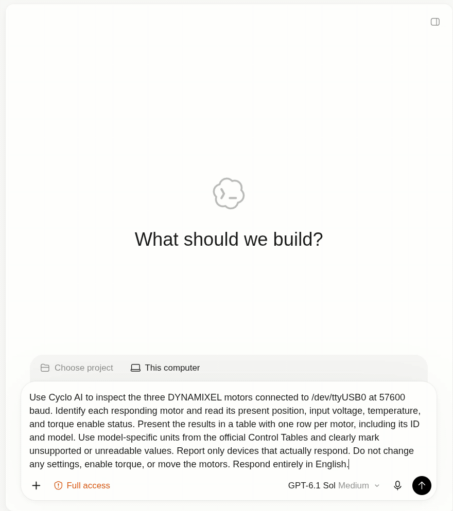

# Cyclo AI


**Build software for DYNAMIXEL actuators and the robots powered by them.**

Cyclo AI helps your coding agent compare actuators, inspect and configure connected devices, and prepare robot control, teleoperation, and learning workflows using official ROBOTIS documentation. It includes a local MCP server and task-specific skills for Codex and Claude Code.

[Quickstart](#quickstart) · [Demo](#see-it-in-action) · [Skill catalog](references/skills.md) · [Documentation](#documentation)

## See it in action

A natural-language prompt reads connected DYNAMIXEL actuators and presents their status in a table, without changing settings or moving the motors.



## What you can do

- **Choose actuators:** compare models, specifications and compatibility using official manuals and implementation references.
- **Inspect and configure devices:** discover connected motors, read model-specific Control Tables, and change supported settings on explicitly selected targets.
- **Develop robot software:** prepare ROS 2 integration, teleoperation, demonstration collection, and learning workflows for DYNAMIXEL-powered robots.

## Quickstart

Use **Node.js 22 or newer** and **Python 3.9 or newer** on the computer that will run the plugin. Hardware access uses the local MCP server; documentation and model-selection questions need no connected robot.

### 1. Prepare the package

For a release installation, extract the `cyclo-ai-<version>-install.zip` asset.
It includes the MCP JavaScript libraries, pyserial, and PyYAML. With Node.js and
Python already installed, run `node scripts/doctor.mjs --hardware-deps` from the
extracted `cyclo-ai` directory, then load it using the host installation guide.
No npm or pip installation is needed for this install ZIP. ROS, simulators,
training frameworks, and physical adapter drivers remain separate prerequisites.

For a source checkout or the source ZIP, install dependencies first:

```sh
git clone https://github.com/ROBOTIS-GIT/cyclo_ai.git
cd cyclo_ai
npm ci --ignore-scripts
npm run setup
npm run doctor -- --hardware-deps
```

Setup creates a local Python environment. The diagnostic command checks dependencies without opening devices.

### 2. Load it in your agent

Follow the [host installation guide](references/hosts.md) to register the prepared directory in Codex or load it in Claude Code. The guide also covers `CYCLO_PRODUCTS_PYTHON` when a host copies the plugin into a cache. These are local installation instructions; a public marketplace installation link will be added after publication.

| Host | Start with |
| --- | --- |
| Codex | `$cyclo` |
| Claude Code | `/cyclo-ai:cyclo` |

### 3. Ask your first question

> Help me choose a DYNAMIXEL actuator for my robot. Ask about my requirements and compare suitable models using official specifications.

For connected devices, provide the port and baud rate, or ask Cyclo AI to help identify them. See [first connection](references/first-run.md) for the complete workflow. Set `CYCLO_OFFLINE=1` in the server environment to disable hardware access.

## Try these prompts

**Compare actuators**

> Compare DYNAMIXEL actuators for my robot based on voltage, torque, speed, and communication requirements. Cite the official specifications.

**Inspect connected motors**

> Inspect the DYNAMIXEL motors connected to `/dev/ttyUSB0` at 57600 baud. Show each responding motor's ID, model, position, voltage, temperature, and torque enable status in a table. Use model-specific units and mark unsupported or unreadable values. Do not change any settings or move the motors.

Replace the port and baud rate with your connection details. Motors sharing a bus need unique IDs for individual identification.

**Prepare robot software**

> Help me prepare a ROS 2 control configuration for my DYNAMIXEL-powered robot. Ask for the joint layout and actuator models you need.

## Supported workflows

| Hardware or product | Workflows |
| --- | --- |
| DYNAMIXEL actuators | Model selection, discovery, Control Table inspection, supported reads and writes |
| Custom DYNAMIXEL-powered robots | Joint-to-actuator mapping and ROS 2, DYNAMIXEL Hardware Interface, and Xacro configuration preparation |
| AI Worker / FFW | Setup, control, teleoperation, and learning preparation |
| OMY | Model-specific setup, control, teleoperation, and learning preparation |
| OMX | Setup and workflow selection for ROS 2 or native LeRobot development |
| AI Sapiens | Connectivity, operation, control, diagnostics, motion preparation, walking, and Sim2Real preparation |

See the [complete catalog of 28 skills](references/skills.md) for individual tasks. The bundled actuator catalog covers 89 documents; executable operations depend on model, firmware and field-specific conditions. This is documentation coverage, not a claim that every model has been physically tested.

Device access requires a compatible local connection and an explicit request for the operation. Robot and training workflows require their own runtime validation. CI covers offline tests on Linux/macOS and dependency setup plus offline MCP startup on Windows; physical adapter compatibility must be checked separately.

## Documentation

| Guide | Use it for |
| --- | --- |
| [Host installation](references/hosts.md) | Codex and Claude Code setup, invocation and environment configuration |
| [First connection](references/first-run.md) | Initial device discovery, selection and configuration |
| [Skill catalog](references/skills.md) | All product and task skills |
| [Tool reference](references/tools.md) | MCP tools, scan behavior, batching and transport support |
| [Control Table support](references/control-table-runtime.md) | Model-aware operations, conditions and remaining gaps |
| [Custom Control Tables](references/custom-control-tables.md) | Importing and reviewing actuator, controller and sensor tables |
| [Runtime configuration](modules/dynamixel/README.md) | Local server and hardware runtime settings |
| [Architecture](references/architecture.md) | How the plugin and runtime fit together |

## Contributing & license

See [CONTRIBUTING](CONTRIBUTING.md) for development setup, tests and packaging. For bugs or questions, open a [GitHub issue](https://github.com/ROBOTIS-GIT/cyclo_ai/issues); report security issues through the process in [SECURITY.md](SECURITY.md).

First-party source is [Apache-2.0](LICENSE). The runtime uses the public official DynamixelSDK and pyserial. See [third-party notices](THIRD_PARTY_NOTICES.md) for dependency licenses and [release preparation](references/releasing.md) for distribution requirements.

For K1 motion imitation, [select BeyondMimic PPO or SuperMimic](skills/ai-sapiens-video-mimic/references/methods.md) independently from Cyclo Lab/MJLab and physics. The read-only `cyclo_mimic` MCP tool returns branch checks and distinct artifact contracts; it does not launch training or validate a robot policy.
